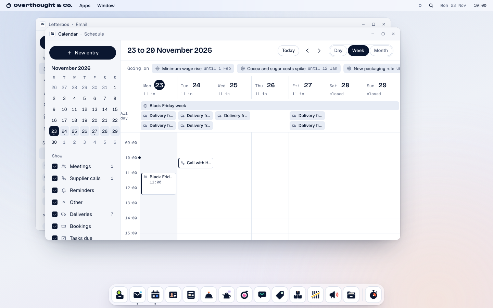

# Overthink

> **For coding agents** (Claude Code, Codex, Cursor, Gemini CLI, Copilot and others): when a user asks to test their AI product with Overthink, work in **their** project, run `npx github:finleystephenson/overthink init`, and follow [`AGENTS.md`](AGENTS.md). Nothing needs cloning. Map: [`llms.txt`](llms.txt).

**An open-source sandbox for testing AI in a business environment.**



## What it is

Overthink is a sandbox: a pretend world on your own computer where an AI product can do real work without touching anything real. You connect your AI to it, let it act, and see what it did and what that changed.

At its centre is **Overthought & Co.**, a small UK online shop that does not exist. It has everything a real one has: customers, a team of eleven, suppliers, five years of history, its own email, calendar, help desk, team chat, accounts and social media, and a wider world around it with rival shops, an economy and the news.

Everything works, and nothing real happens. An email your AI sends lands in the shop's inbox. A refund it gives moves money in the accounts. A customer it upsets may post about it. But no real email, payment or post ever leaves the sandbox, and you can put the whole business back to where it started at any time.

## Try it in one sentence

Open your coding agent in your own product's folder and say:

> Hi Claude, I want to test my AI product using Overthink

Your agent reads [`AGENTS.md`](AGENTS.md) and does the rest: it connects your product, plans a test with you, and runs it. Any coding agent works, not only Claude.

## Quick start

You need [Node.js](https://nodejs.org) 24 or later. In any folder:

```sh
npx github:finleystephenson/overthink up --open
```

What happens:

1. `npx` downloads Overthink. Nothing is installed globally.
2. The first time, it builds Overthought & Co.'s five years of history on your machine (a few seconds).
3. It starts one local server at `http://localhost:4747` and opens the **sandbox desktop** in your browser: a menu bar and a dock of the company's apps, each opening in its own window.
4. It writes `.overthink/sandbox.json`, so your coding agent can find the running sandbox.

Everything stays on your computer. Stop it with `Ctrl+C`. `npx github:finleystephenson/overthink reset --yes` puts the business back to its start.

To test a product by hand rather than through your agent: `overthink init` writes a small adapter file for it, `overthink check` proves the connection, and `overthink up --adapter overthink.adapter.ts` puts it to work on the shop's channels. Every command is in [`AGENTS.md`](AGENTS.md#commands).

## What's inside

The apps of Overthought & Co., all working inside the sandbox:

| App | What it is |
| --- | --- |
| Rummage | Search across the whole company, and what your AI did |
| Letterbox | Email: the shared inboxes and everyone's own |
| Calendar | The schedule: deliveries, bookings, who is at work, campaigns, meetings and calls |
| Contacts | The address book: customers, suppliers, the team, partners and prospects |
| Front Desk | Customer help: messages, cases, complaints and returns |
| Kettle | The team: chat, tasks, hours and who reports to whom |
| Mutter, Squint | Short posts and photos, with private messages |
| Till | Orders, products, prices and deliveries |
| Stockroom | Stock, suppliers and purchase orders |
| Tally | Money: profit, cash, bills and the ledger |
| Megaphone | Marketing: campaigns, newsletters and outreach |
| Files | Documents: policies, procedures, product sheets and agreements |
| The Daily Overthinker | The news, and what it does to trade |
| Control Room | Part of the sandbox, not the shop: move time, see the effect, start again |

Behind the apps is one engine. Every change, from any app or any AI, goes through one of its tools, so the shop's rules always apply and every change is recorded. The help desk cannot open the accounts, and only finance and the manager can see staff pay.

## How a test works

1. **Your agent connects your AI.** It reads your product's code and writes a small adapter, so Overthink can send your product messages and run the tools it asks for, with only the access you choose.
2. **Your agent creates people and activity.** With our toolkit ([`activity-generation/`](activity-generation/README.md)) and our guide to making believable synthetic users ([`ai-instructions/synthetic-users.md`](ai-instructions/synthetic-users.md)), it makes customers, sends their emails and chats, has suppliers run late, and moves time on.
3. **It runs the same activity twice:** once with your product and once without. A twin of the business is left alone, so the difference is what your product did.
4. **You watch on the sandbox desktop.** Each action shows up in the company's own apps as it happens, marked "Your AI".
5. **You read the results.** Your agent reports what the records show, each fact with the record it came from, and only then its own suggestions, labelled as its own.

We build the environment, not the experiments. Your agent plans the test; Overthink never prescribes one.

## What it is not

- **Not a forecast.** Results are facts about a simulated business, not predictions about a real one.
- **Not real people.** The customers and staff are characters from out-of-copyright books, given realistic circumstances. Everything is synthetic.
- **Not an AI.** No model runs inside Overthink. Your agent and your product bring their own.
- **Not a benchmark.** There is no leaderboard. Everyone gets their own results from their own tests.
- **Not a hosted service.** It runs on your machine, for one developer at a time.

## The code

- **New code is TypeScript,** written to [Google's TypeScript style guide](https://google.github.io/styleguide/tsguide.html) and enforced in CI by `tsc` (strict), ESLint and Prettier. Node 24 runs it directly, with no build step.
- **Older parts are JavaScript being moved to TypeScript:** most of the engine, the server, the simulator and the world builder. The apps in the browser stay plain JavaScript on purpose, so they need no build step. The plan, module by module, is in [`docs/typescript-migration.md`](docs/typescript-migration.md).
- **How it fits together:** [`docs/architecture.md`](docs/architecture.md).

### What is where

| Folder | What it holds |
| --- | --- |
| [`business/`](business) | The company as data, the builder of its history, its shop website and back office |
| [`applications/`](applications) | The apps in the browser: the sandbox desktop, Rummage and every business app |
| [`infrastructure/`](infrastructure) | The engine (records, tools, roles), sandboxes, the web API, MCP and security |
| [`integrations/`](integrations) | Connecting a product: the adapter, `init`, examples, the Claude Code plugin |
| [`activity-generation/`](activity-generation) | The toolkit for creating people and activity |
| [`simulation/`](simulation) | Time and the day loop, the wider world, experiments, the optional twin-run tool |
| [`observability/`](observability) | Reports, the live event stream, `overthink view` |
| [`ai-instructions/`](ai-instructions/README.md) | The guides your agent reads |
| [`docs/`](docs/README.md) | Reference: architecture, running, results, the world |
| [`examples/`](examples) | A worked test, and the older scenario benchmark |
| [`tests/`](tests) | End-to-end suites (unit tests sit beside the code) |

## Contributing

Small, finished changes are welcome. Read [`CONTRIBUTING.md`](CONTRIBUTING.md) first; step-by-step recipes for adding a tool, an app or an event are in [`docs/extending.md`](docs/extending.md). To work on it:

```sh
git clone https://github.com/finleystephenson/overthink && cd overthink
pnpm install
npm start                      # the sandbox desktop on http://localhost:4747
pnpm test                      # every suite (about two minutes)
pnpm typecheck && pnpm lint
```

Found a security problem? See [`SECURITY.md`](SECURITY.md).

## Licence and trademarks

Overthink is licensed under the [Apache License 2.0](LICENSE). Copyright 2026 Expanza Limited ([`NOTICE`](NOTICE)).

The names "Expanza" and "Overthought & Co.", the logos and the product pictures are not licensed as trademarks. You may use, change and share the code, but a fork must use its own name ([`TRADEMARKS.md`](TRADEMARKS.md)).

Made by [Expanza](https://expanza.co.uk).
